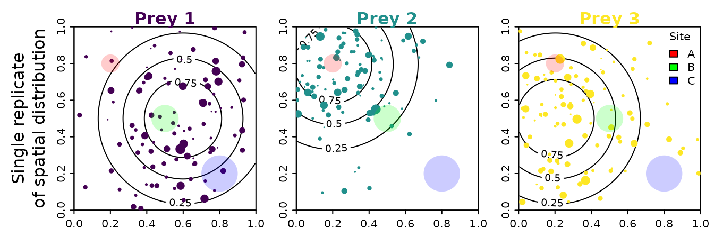
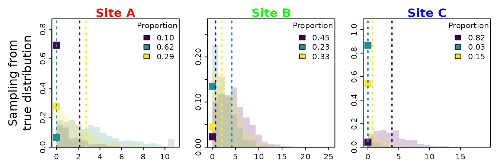
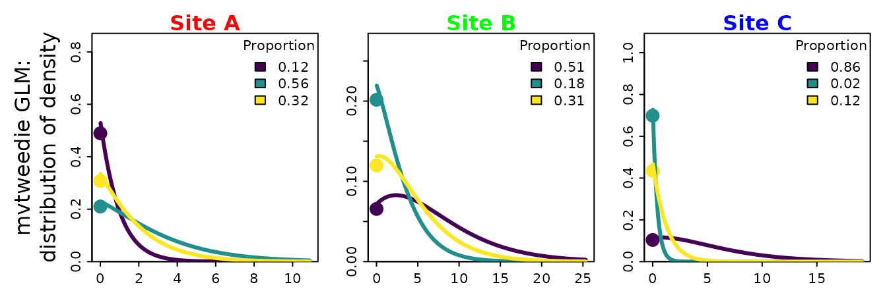
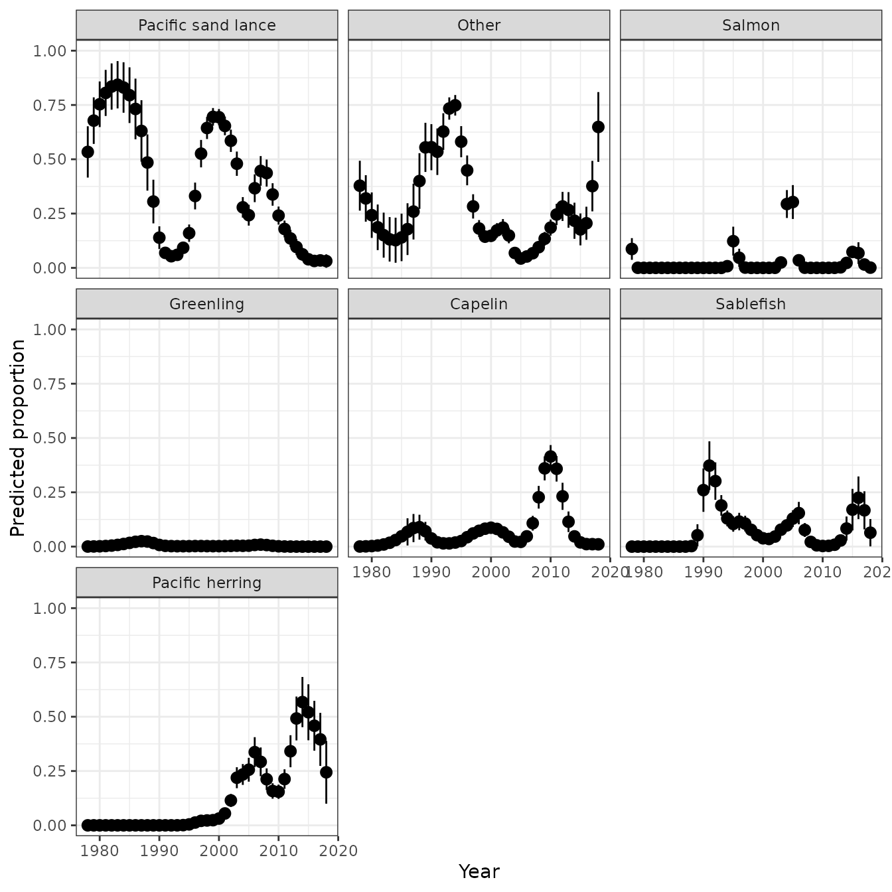
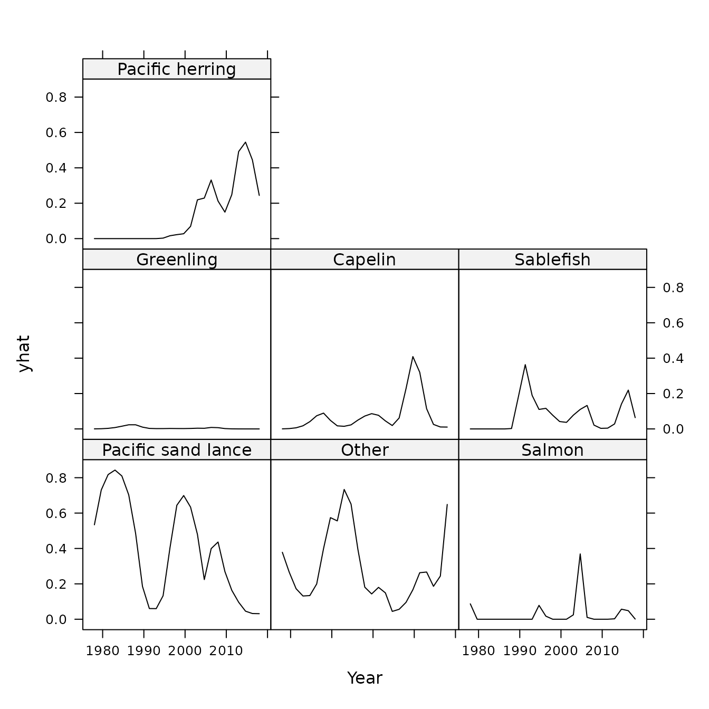
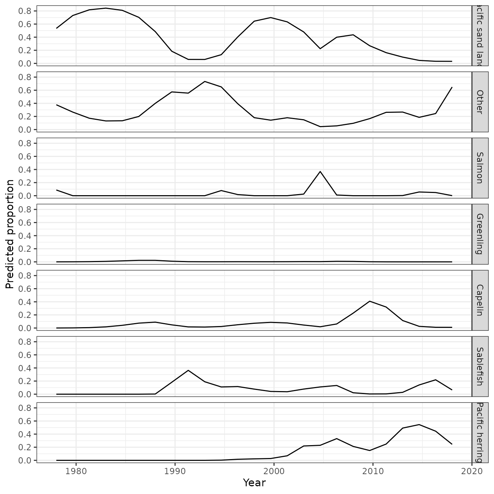
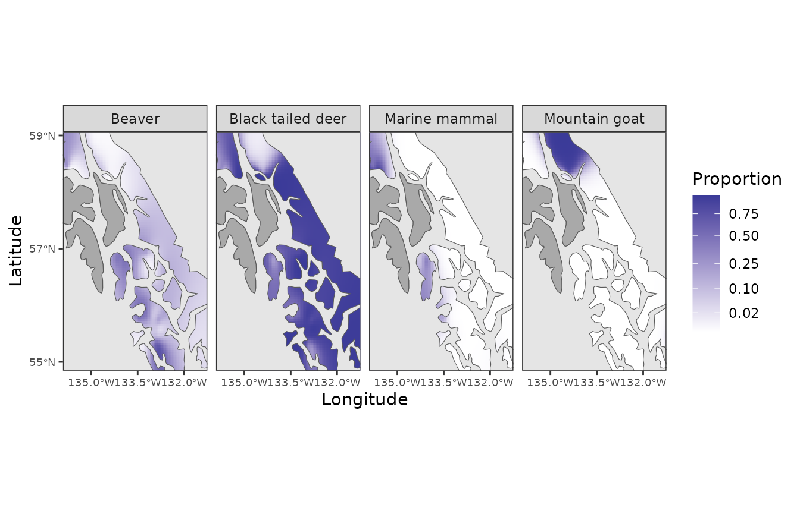

# Introduction to mvtweedie

## Introducing the mvtweedie distribution for regression-based analysis of diet samples

`mvtweedie` is an R package to interpret a Tweedie generalized linear
model (GLM) or generalized additive model (GAM) involving multiple
classes as an estimate of proportions for each class, implicitly
involving a multivariate-logit transformation for parameters and
predictions. This approach generalizes the Poisson-to-multinomial
transformation to allow for non-integer responses, and can analyze
either pre-processed (transformed to proportions) or raw (zero-inflated
positive real values) data.

This approach may be helpful, for example, when analyzing diet samples
that are heavily zero inflated without pre-processing the samples prior
to analysis. In these cases, the Tweedie distribution can be interpreted
mechanistically as a thinned and double-marked Poisson point process
representing foraging processes.

### Ecological motivation

We propose thinking about diet samples as arising from a thinned and
double-marked point process, with marks representing prey category and
size. To visualize this, we simulate a square spatial domain with three
prey species, each having a different utilization distribution (shown
using contours to indicate expected densities). We then simulate a
single realization from this process, plotting the location and size for
each individual of each prey species. We also imagine that a predator
might be sampled at three different locations, and that it has recently
foraged in areas of varied size, labeled sites A, B, and C (shown as
shaded circles), where these foraging areas occur in areas with
different densities of the three prey species.



For this data-generating process, we can simulate multiple replicates to
sample from the true distribution of prey proportions that occurred
within those three sites A, B, or C. This will sometimes be zero for a
given prey (which occurs when no prey individual is within that foraging
patch), and is otherwise a continuous-valued and positive response
(arising as the sum of prey size for all prey individuals in that area).

We first plot samples from this true distribution for the proportion of
each prey at each site, and also calculate the average (expected)
proportion for each prey at each site.



Finally, we can approximate that true distribution for prey proportions
using a generalized linear model with a log-linked Tweedie distribution,
and converting predicted prey densities to a proportion. We will call
this a *multivariate Tweedie* distribution. However, we do not have a
closed-form expression for its moment-generating function, so it could
instead be interpreted as a “multivariate Tweedie generalized estimating
equation”.



Given the potential for this multivariate-Tweedie distribution to
approximate the true distribution for prey proportions (including both
the proportion of zeros, the distribution for positive values, and the
mean proportions), we therefore propose to use this log-linked Tweedie
GLM to fit diet samples and predict resulting prey proportions.

## Example application for tufted puffins on Middleton Island

So far, we have showed that the multivariate Tweedie distribution can
approximate the sampling distribution from a double-marked point
process. We next show how it can be specified as a distribution in a
multi-class generalized linear model, infer covariate effects, and
predict prey proportions. To do so, we first format our data as a
long-form data frame, which includes a row for each combination of prey
and sample, and columns for prey group and sample ID, the measured
quantity in that diet sample for each prey, and any predictor and/or
offset variables.

``` r

# Loading package
library(mvtweedie)

# load data set
data( Middleton_Island_TUPU, package="mvtweedie" )
Middleton_Island_TUPU$Year =
  as.numeric(as.character( Middleton_Island_TUPU$Year_factor ))

# Illustrate format
knitr::kable( head(Middleton_Island_TUPU), digits=1, row.names=FALSE)
```

| Year_factor | Response | group              | SampleID               | Year |
|:------------|---------:|:-------------------|:-----------------------|-----:|
| 1978        |      8.1 | Pacific sand lance | Middleton-TUPU-1978-1  | 1978 |
| 1978        |      1.4 | Pacific sand lance | Middleton-TUPU-1978-10 | 1978 |
| 1978        |     17.7 | Pacific sand lance | Middleton-TUPU-1978-11 | 1978 |
| 1978        |      1.0 | Pacific sand lance | Middleton-TUPU-1978-12 | 1978 |
| 1978        |      2.0 | Pacific sand lance | Middleton-TUPU-1978-13 | 1978 |
| 1978        |      2.2 | Pacific sand lance | Middleton-TUPU-1978-14 | 1978 |

We then fit a log-linked regression model for the prey samples, with
multiple responses for each sample. In this case, we use *mgcv* to fit a
Generalized Additive Model (GAM) and specifically include:

1.  a smoothing term `s(Year)` that is shared among prey groups,
    representing variation over time in the expected prey biomass in
    each diet sample;
2.  a smoothing term `s(Year,by=group)` that differs among prey groups,
    representing prey switching over time;
3.  a group-specific intercept `0 + group` that represents expected
    differences in prey proportion on average over time.

The first term is essentially a “detectability” covariate, representing
changes in attack and capture rates over time that affect the sampled
value for all prey in a given year. It could be replaced by a fixed or
random effect for each sample, although such a model is slow using
*mgcv*. It has a equal effect for predicted measurements for each prey
category (because we are fitting using a log-linked model), and
therefore “drops out” when predicting prey proportions. Alternatively,
we could pre-process the data such that each sample has a constant mean
prey density. This will be (roughly) similar to marginalizing across the
unmodeled variation in total prey measurement for each sample.

``` r

# Run Tweedie GLM
library(mgcv)
gam0 = gam(
  formula = Response ~ 0 + group + s(Year,by=group) + s(Year),
  data = Middleton_Island_TUPU,
  family = tw
)

# Load class to enable predict.mvtweedie
mygam = gam0
class(mygam) = c( "mvtweedie", class(mygam) )
```

The fitted GAM `gam0` does not include any covariance in the response
for each prey species (conditional upon the estimated response to terms
that are included in the `formula`). However, `predict(mygam)` will now
predict the response as proportions across modeled categories, and does
include a negative covariance among categories.

### Visualizing covariate responses

After fitting the model, we can visualize the predicted proportion for
each prey as a function of covariates.

In this simple example, we can manually construct a predictive grid for
our covariate `Year`, calculate predictions, and then plot using
*ggplot*.

``` r

# Predict values
newdata = expand.grid( 
  "group" = levels(Middleton_Island_TUPU$group),
  "Year" = 1978:2018 
)
pred = predict( 
  mygam,
  se.fit = TRUE,
  newdata = newdata 
)
newdata = cbind( newdata, fit=pred$fit, se.fit=pred$se.fit )
newdata$lower = newdata$fit - newdata$se.fit
newdata$upper = newdata$fit + newdata$se.fit

# Plot
library(ggplot2)
theme_set(theme_bw())
ggplot(newdata, aes(Year, fit)) +
  geom_pointrange(aes(ymin = lower, ymax = upper)) +
  facet_wrap(vars(group)) +
  ylim(0,1) +
  labs(y="Predicted proportion")
```



In more complicated models, however, it might be cumbersome to construct
a full grid across all covariates. We can instead automate this process
using third-party packages. Here, we show how to use *pdp* to calculate
a partial dependence plot:

``` r

library(pdp)

# Make function to interface with pdp
pred.fun = function( object, newdata ){
  predict( object = object,
           category_name = "group",
           newdata = newdata )
}

# Calculate partial dependence
# approx = TRUE gives effects for average of other covariates
# approx = FALSE gives each pdp curve
Partial = partial(
  object = mygam,
  pred.var = c( "Year", "group"),
  pred.fun = pred.fun,
  train = mygam$model,
  approx = TRUE
)

# Lattice plots as default option
library( lattice )
plotPartial( Partial )
```



``` r


# using in ggplot2
ggplot(data=Partial, aes(x=Year, y=yhat)) + # , group=yhat.id
  geom_line( ) +
  facet_grid( vars(group) ) +
  labs(y="Predicted proportion")
```



In this simple example, the partial dependence plot and predictive grid
both result in the same visualization of effects. However, this is not
guaranteed to be the case in models with more covariates.

## Spatial analysis of wolf prey

We next demonstrate how the multivariate Tweedie can be used in a
spatial analysis to predict diet proportions. We use samples of
environmental DNA from wolf scats collected in southeast Alaska, and
restrict analysis to four selected prey species to speed up model
fitting (the model would likely be faster using software that is
specialized for multivariate spatio-temporal analysis).

``` r

# Load data
data(southeast_alaska_wolf)
groups = c("Black tailed deer","Marine mammal", "Mountain goat", "Beaver")
southeast_alaska_wolf = subset(
  southeast_alaska_wolf,
  group %in% groups 
)

# 
southeast_alaska_wolf$group = factor(southeast_alaska_wolf$group)

# Illustrate format
knitr::kable( head(southeast_alaska_wolf), digits=1, row.names=FALSE)
```

| Latitude | Longitude | group             | Response |
|---------:|----------:|:------------------|---------:|
|     55.2 |    -131.8 | Black tailed deer |   1469.7 |
|     58.4 |    -135.7 | Black tailed deer |   4684.2 |
|     55.8 |    -133.0 | Black tailed deer |  24852.5 |
|     55.8 |    -133.0 | Black tailed deer | 112592.0 |
|     56.2 |    -133.0 | Black tailed deer |   3585.5 |
|     55.5 |    -132.8 | Black tailed deer |  40730.0 |

We then fit a generalized additive model with a tensor-spline
interaction of Latitude and Longitude.

``` r

# Formula
Formula = Response ~ 
  0 + group + 
  s(Latitude,Longitude,m=c(1,0.5),bs="ds") +
  s(Latitude,Longitude,by=group,m=c(1,0.5),bs="ds")


# Using mgcv
gam_wolf = gam(
  formula = Formula,
  data = southeast_alaska_wolf,
  family = tw 
)
class(gam_wolf) = c( "mvtweedie", class(gam_wolf) )
```

Finally, we define a function that computes predictions on a grid formed
from different values of each predictor:

``` r

predict_grid <-
function( model,
          exclude_terms = NULL,
          length_out = 50,
          values = NULL,
          ... ){

  if( !any(c("gam","glmmTMB") %in% class(model)) ){
    stop("`predict_grid` only implemented for mgcv and glmmTMB")
  }
  n_terms <- length(model[["var.summary"]])
  term_list <- list()
  for (term in 1:n_terms) {
    term_summary <- model[["var.summary"]][[term]]
    term_name <- names(model[["var.summary"]])[term]
    if (term_name %in% names(values)) {
      new_term <- values[[which(names(values) == term_name)]]
      if (is.null(new_term)) {
        new_term <- model[["var.summary"]][[term]][[1]]
      }
    }
    else {
      if (is.numeric(term_summary)) {
        min_value <- min(term_summary)
        max_value <- max(term_summary)
        new_term <- seq(min_value, max_value, length.out = length_out)
      }
      else if (is.factor(term_summary)) {
        new_term <- levels(term_summary)
      }
      else {
        stop("The terms are not numeric or factor.\n")
      }
    }
    term_list <- append(term_list, list(new_term))
    names(term_list)[term] <- term_name
  }
  new_data <- expand.grid(term_list)
  class(model) = c( "mvtweedie", class(model) )
  pred <- predict( model,
                   newdata = new_data,
                   se.fit = TRUE,
                   ...)
  predicted <- as.data.frame(pred)
  predictions <- cbind(new_data, predicted)
  return(predictions)
}
```

We use this function to visualize prey proportions across the landscape
of southeast Alaska that is inhabited by wolves:

``` r

library(rnaturalearth)
library(raster)
library(sf)
library(dplyr)

# Predict raster on map
pred_wolf = predict_grid( gam_wolf,
                 length_out = 100 )
pred_wolf$cv.fit = pred_wolf$se.fit / pred_wolf$fit

# Map oceanmap layer
US_high = ne_countries(scale=50, country="united states of america")
st_box = st_polygon( list(cbind( x=c(-140,-125,-124,-140,-140), 
                                 y=c(50,50,60,60,50))) )
st_box = st_sfc(st_box, crs=st_crs(US_high) )
wmap = st_intersection( US_high, st_box )
oceanmap = st_difference( st_as_sfc(st_bbox(wmap)), wmap )

sf.isl <- data.frame(island = c("Baranof", "Chichagof", "Admiralty"), 
                     lat = c(57.20583, 57.88784, 57.59644), 
                     lon = c(-135.1866, -136.0024, -134.5776)) %>%
  st_as_sf(., coords = c("lon", "lat"), crs = 4326) 

mask.land = ne_countries(scale=50, country="united states of america", returnclass = 'sf') %>%
  st_set_crs(., 4326) %>%
  st_cast(., "POLYGON") %>%
  st_join(., sf.isl) %>% 
  filter(!is.na(island))

# Make figure
my_breaks = c(0.02,0.1,0.25,0.5,0.75)
ggplot(oceanmap) +
  geom_tile(data=pred_wolf, aes(x=Longitude,y=Latitude,fill=fit)) +
  geom_sf() +
  geom_sf(data = mask.land, inherit.aes = FALSE, fill = "darkgrey") + 
  coord_sf(xlim=range(pred_wolf$Longitude), ylim=range(pred_wolf$Latitude), expand = FALSE) +
  facet_wrap(vars(group), ncol = 5) +
  scale_fill_gradient2(name = "Proportion", trans = "sqrt", breaks = my_breaks) +
  scale_y_continuous(breaks = seq(55,59,2)) +
  scale_x_continuous(breaks = c(-135, -133.5, -132)) +
  theme(axis.text = element_text(size = 7))
```



These results visualize spatial prey switching, e.g., a greater
proportion of marine mammals in wolf diets in islands.

## Works cited
